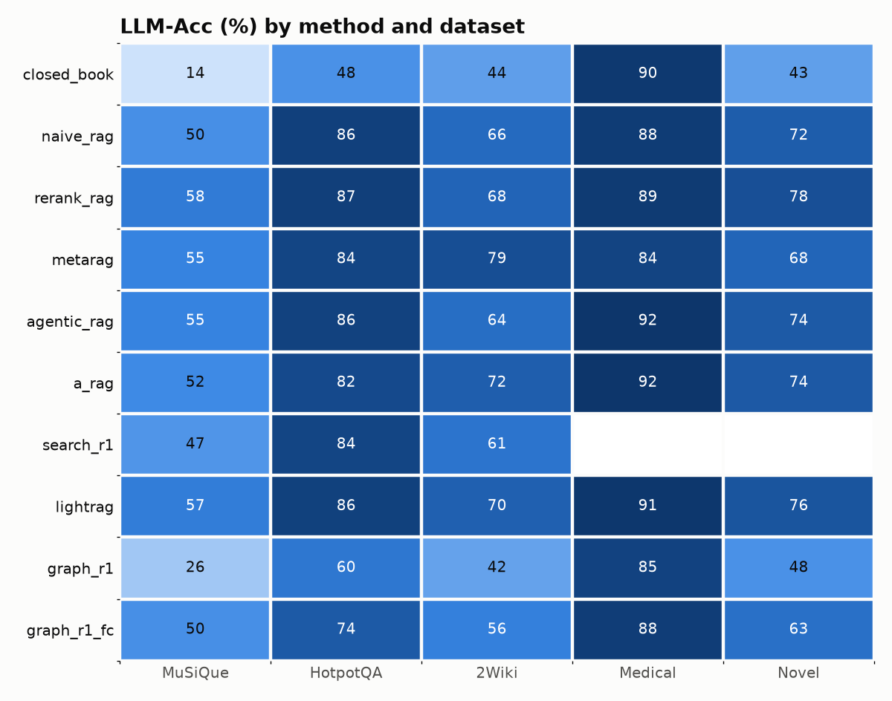
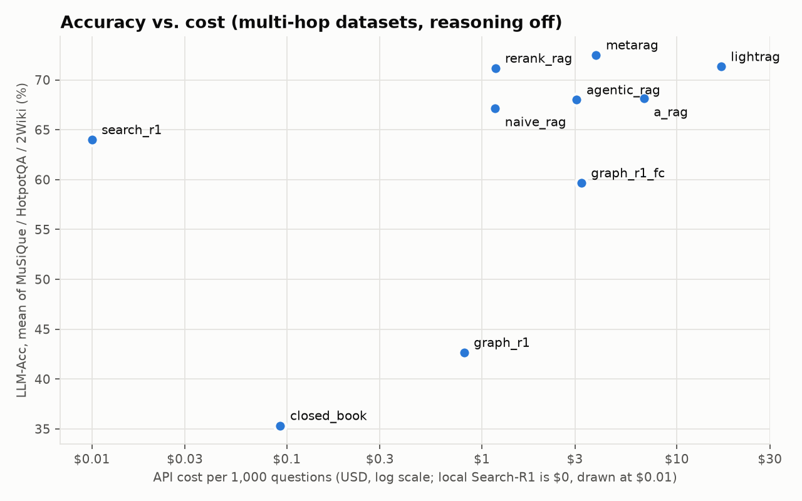
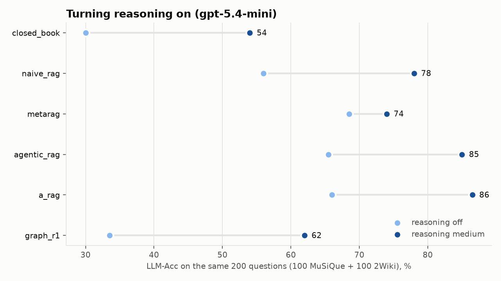

# RAG in 2026: nine retrieval strategies, one search engine, five datasets

A reproducible head-to-head of recent RAG ideas — **agentic RAG, A-RAG (Feb 2026), Search-R1
(RL-trained search agent), Graph-R1 (ICML 2026), LightRAG, MetaRAG** — against plain and reranked
hybrid search. Every method runs on the **same OpenSearch index, the same embedding model, the same
generator LLM and the same questions**, so the only thing that changes is *how the system asks for data*.

> Companion repository for a blog post. Code, raw per-question results, costs and traces are all here.

## Key findings

1. **The generator's reasoning mattered more than any retrieval architecture.** Same questions, same
   indexes, only `reasoning_effort` changed from `"none"` to `"medium"` (100 MuSiQue + 100 2Wiki questions):
   naive RAG 56 → 78 %, `agentic_rag` 66 → 85 %, A-RAG 66 → 86 %, Graph-R1 34 → 62 %.
   With reasoning on, the agentic loops are clearly best; with it off they barely beat one-shot retrieval.
2. **With reasoning off, the methods cluster within the noise.** Multi-hop averages: MetaRAG 72.5, LightRAG 71.3,
   hybrid + reranker 71.2, A-RAG 68.2, agentic RAG 68.0, naive hybrid 67.2 (95 % CIs are ±6–7 pp per dataset).
   A local cross-encoder on top of OpenSearch hybrid search reaches the top cluster for **$1.26 per 1,000
   questions**; LightRAG costs **14× more per query** (~23k context tokens) plus a ~$20 graph build.
3. **MetaRAG is a reasoning prosthesis.** Its monitor → critic → planner loop is the best method on 2Wiki with
   reasoning off (79 % vs 65.5 % naive), but gains only +5 pp when the model itself reasons, ending below naive RAG.
4. **Graph-R1 needs its RL-trained policy.** Without released weights, the prompted policy issues one query for
   93 % of 2Wiki questions and scores below naive RAG. Giving the same hypergraph to a function-calling loop
   (`graph_r1_fc`) adds +17 pp on multi-hop; reasoning adds +28 pp. LLM-rewritten hyperedges still lose detail
   that raw passages keep (context recall 59 % vs 65–83 % for the passage-based methods).
5. **Search-R1, a 7B RL-trained search agent on a laptop**, lands at 64.0 % on multi-hop — within 4 pp of
   `gpt-5.4-mini` naive RAG on the same 100 questions per dataset (67.7 %), tied on MuSiQue (47 vs 47).
   It searches ~3 times per question and retrieves as well as the frontier-model agent loop (context recall
   73.7 % vs 73.5 % for `agentic_rag`), but is a weaker reader. $0 API cost, 1–2 minutes per question on an M3.
6. **Benchmark hygiene:** GraphRAG-Bench Medical is saturated (closed-book 90 %); MuSiQue is the dataset that
   separates methods (closed-book 14 %).







**Total API spend for everything in this repository: ≈ $80** (generator, judge, graph indexing, experiment 2;
embeddings, reranker and Search-R1 ran locally).

## Results

All numbers below are generated by `uv run ragbench report` from `results/runs/`. n = 200 questions per dataset,
except Search-R1 (n = 100: the first 100 of the same sample; local inference is slow). LightRAG's MuSiQue graph is
missing one of 22 inserted documents (64 of 1,354 chunks) that LightRAG refused to repair after an interrupted build.

<!-- RESULTS:START (generated by `ragbench report`) -->

### LLM-Acc (%) by dataset, 95% bootstrap CI in brackets

| Method | MuSiQue | HotpotQA | 2Wiki | Medical | Novel | Multi-hop avg | All-5 avg |
|---|---|---|---|---|---|---|---|
| `closed_book` | 14.0 [9.5–19.0] | 48.5 [42.0–55.5] | 43.5 [37.0–50.5] | 90.0 [85.5–94.0] | 43.0 [36.0–50.0] | **35.3** | 47.8 |
| `naive_rag` | 49.5 [42.0–56.5] | 86.5 [82.0–91.0] | 65.5 [59.0–72.0] | 88.5 [84.0–92.5] | 72.0 [65.5–78.0] | **67.2** | 72.4 |
| `rerank_rag` | 58.0 [51.0–65.0] | 87.0 [82.5–91.5] | 68.5 [62.0–74.5] | 89.0 [84.5–93.0] | 78.5 [73.0–84.0] | **71.2** | 76.2 |
| `metarag` | 54.5 [47.5–61.5] | 84.0 [78.5–89.0] | 79.0 [72.5–84.5] | 84.5 [79.5–89.5] | 68.0 [62.0–74.5] | **72.5** | 74.0 |
| `agentic_rag` | 54.5 [47.5–61.5] | 85.5 [80.5–90.0] | 64.0 [57.5–70.5] | 92.0 [88.0–95.5] | 73.5 [67.0–79.5] | **68.0** | 73.9 |
| `a_rag` | 51.5 [45.0–58.0] | 81.5 [76.0–86.5] | 71.5 [65.0–77.5] | 91.5 [87.5–95.0] | 74.0 [68.0–80.0] | **68.2** | 74.0 |
| `search_r1` | 47.0 [37.0–57.0] | 84.0 [77.0–91.0] | 61.0 [52.0–71.0] | – | – | **64.0** | – |
| `lightrag` | 57.5 [50.5–64.5] | 86.0 [81.5–90.5] | 70.5 [64.0–76.5] | 91.0 [87.0–94.5] | 76.0 [70.0–81.5] | **71.3** | 76.2 |
| `graph_r1` | 26.0 [20.0–32.5] | 60.0 [53.0–67.0] | 42.0 [35.0–49.0] | 85.0 [80.0–90.0] | 48.5 [41.5–55.5] | **42.7** | 52.3 |
| `graph_r1_fc` | 49.5 [42.5–56.5] | 73.5 [67.5–79.5] | 56.0 [49.0–63.0] | 88.0 [83.5–92.5] | 63.0 [56.5–69.5] | **59.7** | 66.0 |

### Short-answer metrics, averaged over MuSiQue / HotpotQA / 2Wiki (%)

| Method | LLM-Acc | Contain | EM | F1 | Ctx-Recall |
|---|---|---|---|---|---|
| `closed_book` | 35.3 | 28.8 | 26.0 | 34.3 | 0.0 |
| `naive_rag` | 67.2 | 55.7 | 44.8 | 58.0 | 67.2 |
| `rerank_rag` | 71.2 | 60.2 | 49.5 | 61.3 | 71.0 |
| `metarag` | 72.5 | 59.0 | 52.0 | 63.0 | 65.3 |
| `agentic_rag` | 68.0 | 57.0 | 48.7 | 59.1 | 73.5 |
| `a_rag` | 68.2 | 57.8 | 50.2 | 60.3 | 76.2 |
| `search_r1` | 64.0 | 52.3 | 48.0 | 57.2 | 73.7 |
| `lightrag` | 71.3 | 58.2 | 48.2 | 60.7 | 82.5 |
| `graph_r1` | 42.7 | 34.3 | 31.5 | 38.4 | 25.2 |
| `graph_r1_fc` | 59.7 | 48.8 | 43.0 | 52.8 | 59.3 |

### Cost and effort per question (mean over all datasets)

| Method | $ / 1k questions | LLM calls | Searches | Input tok | Output tok | p50 latency (s) | Errors |
|---|---|---|---|---|---|---|---|
| `closed_book` | 0.17 | 1.0 | 0.0 | 47 | 29 | 0.8 | 0 |
| `naive_rag` | 1.25 | 1.0 | 1.0 | 1,500 | 28 | 0.9 | 0 |
| `rerank_rag` | 1.26 | 1.0 | 1.0 | 1,513 | 27 | 1.0 | 0 |
| `metarag` | 3.14 | 4.2 | 1.1 | 4,250 | 178 | 1.9 | 0 |
| `agentic_rag` | 2.71 | 2.5 | 1.9 | 3,231 | 86 | 2.0 | 0 |
| `a_rag` | 6.68 | 3.3 | 1.8 | 8,548 | 123 | 2.8 | 0 |
| `search_r1` | 0.00 | 4.0 | 3.0 | 4,918 | 206 | 69.5 | 0 |
| `lightrag` | 17.41 | 2.0 | 1.0 | 22,850 | 61 | 5.3 | 0 |
| `graph_r1` | 0.84 | 1.7 | 1.4 | 705 | 70 | 1.7 | 0 |
| `graph_r1_fc` | 3.01 | 3.4 | 5.5 | 3,646 | 109 | 3.0 | 0 |

### One-off graph indexing cost (gpt-4o-mini)

| Method | Dataset | LLM calls | $ |
|---|---|---|---|
| `graph_r1` | MuSiQue | 1,354 | 2.62 |
| `lightrag` | MuSiQue | 9,732 | 5.99 (est.) |
| `graph_r1` | HotpotQA | 1,311 | 2.46 |
| `lightrag` | HotpotQA | 8,497 | 5.23 (est.) |
| `graph_r1` | 2Wiki | 658 | 1.33 |
| `lightrag` | 2Wiki | 4,472 | 2.75 (est.) |
| `graph_r1` | Medical | 225 | 0.36 |
| `lightrag` | Medical | 1,725 | 1.06 |
| `graph_r1` | Novel | 1,117 | 1.65 |
| `lightrag` | Novel | 7,318 | 4.50 (est.) |

### Experiment 2: same methods with `reasoning_effort="medium"` (paired, same questions)

| Method | Dataset | n | LLM-Acc none | LLM-Acc medium | Δ (pp) | $ / 1k none | $ / 1k medium |
|---|---|---|---|---|---|---|---|
| `closed_book` | 2Wiki | 100 | 43.0 | 63.0 | +20.0 | 0.09 | 7.14 |
| `closed_book` | MuSiQue | 100 | 17.0 | 45.0 | +28.0 | 0.10 | 10.01 |
| `naive_rag` | 2Wiki | 100 | 65.0 | 85.0 | +20.0 | 1.19 | 2.46 |
| `naive_rag` | MuSiQue | 100 | 47.0 | 71.0 | +24.0 | 1.16 | 4.31 |
| `metarag` | 2Wiki | 100 | 81.0 | 84.0 | +3.0 | 3.88 | 6.98 |
| `metarag` | MuSiQue | 100 | 56.0 | 64.0 | +8.0 | 3.84 | 9.00 |
| `agentic_rag` | 2Wiki | 100 | 70.0 | 94.0 | +24.0 | 2.81 | 6.89 |
| `agentic_rag` | MuSiQue | 100 | 61.0 | 76.0 | +15.0 | 3.83 | 13.25 |
| `a_rag` | 2Wiki | 100 | 75.0 | 92.0 | +17.0 | 6.14 | 11.06 |
| `a_rag` | MuSiQue | 100 | 57.0 | 81.0 | +24.0 | 7.78 | 28.25 |
| `graph_r1` | 2Wiki | 100 | 38.0 | 68.0 | +30.0 | 0.88 | 7.01 |
| `graph_r1` | MuSiQue | 100 | 29.0 | 56.0 | +27.0 | 0.82 | 7.48 |

<!-- RESULTS:END -->

## What is compared

| Method | Family | One-line idea |
|---|---|---|
| `closed_book` | baseline | the LLM alone, no retrieval |
| `naive_rag` | baseline | one OpenSearch hybrid query (BM25 + k-NN, RRF) → top-8 passages → answer |
| `rerank_rag` | baseline | hybrid top-30 → `bge-reranker-v2-m3` → top-8 → answer |
| `metarag` | metacognitive | answer, *monitor* agreement with an independent expert, *evaluate* what is missing, *plan* a new query, repeat (WWW'24) |
| `agentic_rag` | agentic | the LLM drives a single `search` tool in a loop |
| `a_rag` | agentic | the LLM gets *hierarchical* tools — exact keyword search, sentence-level semantic search, full-chunk reading (arXiv 2602.03442, Feb 2026) |
| `search_r1` | RL-trained | a 7B model trained with PPO to interleave `<think>`, `<search>` and `<answer>` (Search-R1), run locally |
| `lightrag` | graph | entity/relation graph extracted by an LLM, queried with local + global keywords (LightRAG) |
| `graph_r1` | graph + agentic | n-ary knowledge hypergraph + a think/query/retrieve/answer agent loop (Graph-R1, ICML'26) |
| `graph_r1_fc` | ablation | Graph-R1's hypergraph retriever driven by `agentic_rag`'s function-calling loop instead of its tag protocol |

Details, faithfulness notes and every adaptation: [`docs/methods.md`](docs/methods.md).

## Setup

| | |
|---|---|
| Search engine | OpenSearch 2.19 (Docker): BM25 `english` analyzer + Lucene HNSW k-NN, native `hybrid` query with an RRF search pipeline |
| Embeddings | `BAAI/bge-base-en-v1.5`, local (Apple M3, MPS) |
| Reranker | `BAAI/bge-reranker-v2-m3`, local |
| Generator | `gpt-5.4-mini`, `reasoning_effort="none"` for every method |
| Graph extraction | `gpt-4o-mini` (what the LightRAG / Graph-R1 papers used) |
| Judge | `gpt-4.1-mini` (different model family from the generator), A-RAG's correct/incorrect rubric |
| RL agent | `SearchR1-nq_hotpotqa_train-qwen2.5-7b-em-ppo`, Q4_K_M GGUF, llama.cpp on Metal |

### Datasets

The unified release used by LinearRAG and A-RAG ([`Ayanami0730/rag_test`](https://huggingface.co/datasets/Ayanami0730/rag_test)),
so numbers can be compared with those papers' tables. Each dataset has its own closed corpus.

| Dataset | Kind | Corpus chunks | Questions available | Sampled |
|---|---|---|---|---|
| MuSiQue | 2–4 hop Wikipedia QA | 1,354 | 1,000 | 200 |
| HotpotQA | 2 hop Wikipedia QA | 1,311 | 1,000 | 200 |
| 2WikiMultiHopQA | 2–4 hop Wikipedia QA | 658 | 1,000 | 200 |
| Medical (GraphRAG-Bench) | domain QA, sentence answers | 225 | 2,062 | 200 (Fact Retrieval + Complex Reasoning) |
| Novel (GraphRAG-Bench) | Project Gutenberg novels, sentence answers | 1,117 | 2,010 | 200 (Fact Retrieval + Complex Reasoning) |

Samples are deterministic (`seed=42`); GraphRAG-Bench samples are stratified over the two question types
whose answers can be judged correct/incorrect (summaries and creative writing are excluded).

### Metrics

* **LLM-Acc** – judge says the answer matches the gold answer (main metric; the only one for Medical/Novel)
* **Contain** – normalized gold answer is a substring of the prediction (A-RAG's Cont-Acc)
* **EM / F1** – SQuAD-normalized exact match and token F1
* **Ctx-Recall** – the gold answer string appears in the corpus text the method showed the LLM (a retrieval proxy)
* **Cost** – measured from API usage (cached-token discounts included), plus one-off graph-indexing cost
* **Effort** – LLM calls, search calls, input/output tokens, latency per question
* 95% bootstrap confidence intervals over questions

## Reproduce

```bash
# 1. search engine
docker compose up -d                       # OpenSearch on :9200

# 2. python env + data
uv sync
python scripts/download_data.py            # -> data/raw/<dataset>/{chunks,questions}.json
export OPENAI_API_KEY=...

# 3. indexes (embeddings run locally; graph builds call gpt-4o-mini)
uv run ragbench index                                  # passages / sentences / chunks for all datasets
uv run ragbench index --method graph_r1                # + Graph-R1 hypergraph
uv run ragbench index --method lightrag                # + LightRAG graph

# 4. Search-R1 (optional, local)
brew install llama.cpp
huggingface-cli download mradermacher/SearchR1-nq_hotpotqa_train-qwen2.5-7b-em-ppo-GGUF \
  SearchR1-nq_hotpotqa_train-qwen2.5-7b-em-ppo.Q4_K_M.gguf --local-dir models
llama-server -m models/SearchR1-nq_hotpotqa_train-qwen2.5-7b-em-ppo.Q4_K_M.gguf --port 8081 -ngl 99 -c 16384 -np 2

# 5. run + report
uv run ragbench run --methods closed_book naive_rag rerank_rag metarag agentic_rag a_rag graph_r1 lightrag search_r1 -n 200
uv run ragbench report                     # -> results/summary.md, results/*.csv, results/figures/*.png
```

Runs are resumable (one JSONL line per question in `results/runs/<dataset>/<method>.jsonl`) and every
LLM response is cached in `.cache/llm_cache.sqlite`, so re-running costs nothing. A hard spend cap
(`RAGBENCH_BUDGET_USD`, default and maximum $97, under an absolute $100 limit) stops new API calls before the
spend can pass $100.

## Repository layout

```
src/ragbench/
  config.py        models, prices, paths
  llm.py           OpenAI client: usage/cost tracking, response cache, budget cap
  data.py          corpus -> passages / sentences, question sampling
  embed.py         local bge embeddings + cross-encoder reranker
  search.py        OpenSearch: BM25, k-NN, hybrid (RRF pipeline), phrase search with highlights
  index.py         build the shared indexes
  metrics.py       EM, F1, Contain, LLM judge, context recall, bootstrap CIs
  runner.py        run a method on a dataset (concurrent, resumable)
  report.py        tables + figures
  methods/         one file per family: baselines, metarag, agentic (agentic_rag, a_rag),
                   search_r1, lightrag_method, graph_r1
results/
  runs/            raw per-question JSONL (prediction, metrics, usage, trace)
  summary.md/.csv  aggregated tables
  figures/         plots used in the post
docs/methods.md    what each method is, what is faithful, what is adapted
```

## License and credits

Code: MIT. Prompts and tool descriptions of A-RAG, Search-R1, MetaRAG and Graph-R1 are taken from
their public repositories (linked in `docs/methods.md`) and remain under their authors' licenses.
Datasets: MuSiQue, HotpotQA, 2WikiMultiHopQA and GraphRAG-Bench, via the A-RAG unified release.
